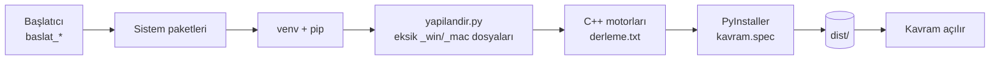
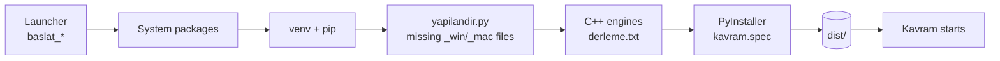

<div align="center">


# Kavram

**Ortak tasarım dilli, çok editörlü masaüstü çalışma ortamı**<br>
**A multi-editor desktop workspace with one shared design language**


[**Türkçe**](#türkçe) · [**English**](#english)

</div>

---

# Türkçe

## İçindekiler

- [Kavram nedir?](#kavram-nedir)
- [Durum](#durum)
- [Hızlı kurulum](#hızlı-kurulum)
- [Kurulum betikleri](#kurulum-betikleri)
- [Program yapısı](#program-yapısı)
- [İş akışı](#i̇ş-akışı)
- [İşletim sistemine özel dosyalar](#i̇şletim-sistemine-özel-dosyalar)
- [Ortak tasarım dili](#ortak-tasarım-dili)
- [Windows ve macOS'ta kayıt](#windows-ve-macosta-kayıt)
- [Geliştirici notları](#geliştirici-notları)
- [Lisans](#lisans)

## Kavram nedir?

Kavram, tek bir çekirdek (`kavram.py`) altında çalışan, **12 küçük editör/araçtan** oluşan bir masaüstü uygulamasıdır.
Hepsi aynı renkleri, aynı düğme tasarımını ve aynı üst barı kullanır; böylece tek bir sistemin parçaları gibi görünürler.
Sağ üst köşedeki **Export** ve **editör adı** düğmeleriyle editörler arasında geçiş yapılır.

| Program | Ne yapar |
|---|---|
| **text** | Metin düzenleme (`.txr`), sembol paneli, otomatik kaydırma / okuma modu, arama |
| **drawing** | 2B çizim ve kare kare animasyon editörü: ızgara, katmanlar, renk karıştırma, video arka plan |
| **sound** | Ses düzenleme ve kayıt: dalga formu, kes / sil, filtre bağlantısı (C++ motor, PortAudio) |
| **media** | Karma medya / arşiv düzenleme: zaman çizelgesi, kamera + mikrofon kaydı, kesme, arşivleme |
| **rec** | Ekran, kamera ve ses kaydedici: segmentli kayıt, yüzen kamera, tuş gösterimi |
| **sphere** | Kare/kutu sahnesi; karelere editör bağlama, `.kitap` şifreli dışa/içe aktarma (AES-GCM + PBKDF2), terminal komutlarıyla çoklu şifre alanı |
| **ai** | Yapay hafıza programı: hafıza paketleri, sohbet, veri düzenleme |
| **copy** | Not / kopyalama galerisi: renkli notlar, panoya kopyalama |
| **filter** | Ses temizleme: gürültü profili, gürültü azaltma, önizleme |
| **converter** | Evrensel dönüştürücü (FFmpeg tabanlı C++ motor) |
| **file_manager** | `File` / `Export` penceresi: klasör gezinme, yer imleri, önizleme |
| **terminal** | Yerleşik komut penceresi |

## Durum

| Sistem | Durum | Not |
|---|---|---|
| **Linux** | Destekleniyor | Paket (`dist/kavram/kavram`) derlenip açıldığı doğrulandı. Kullanılan ana sistem. |
| **Windows 10/11** | Deneysel | Kod ve betikler hazır; Linux üzerinde taklitle ve parça parça denendi, **gerçek Windows'ta henüz doğrulanmadı**. |
| **macOS 11+** | Deneysel | Aynı durum: **gerçek Mac'te henüz doğrulanmadı**. |

> Windows ve macOS'ta ilk çalıştırmada bir adımın takılması olasıdır. Çıktıyı bir *issue* olarak paylaşırsanız düzeltilir.
> Ekran/kamera/mikrofon kayıt altyapısını gerçek cihazda denemek için: [`kayit_testi.py`](#windows-ve-macosta-kayıt).

## Hızlı kurulum

Kavram klasöründe (yani `kavram.py`'nin yanında) işletim sisteminize uygun **başlatıcıyı** çalıştırın.
Başlatıcı sistem paketlerini kurar, sanal ortamı (venv) hazırlar, C++ motorlarını derler, programı **paketler** (`dist/`) ve başlatır.

| Sistem | Çalıştırın | Üretilen |
|---|---|---|
| Linux | `bash baslat_linux.sh` | `dist/kavram/kavram` + `dist/*.tar.gz` |
| Windows | `baslat_win.bat` dosyasına çift tıklayın | `dist\kavram\kavram.exe` + `.zip` + masaüstü kısayolu |
| macOS | `baslat_mac.command` dosyasına çift tıklayın | `dist/Kavram.app` + `.dmg` + `.zip` |

Her paket **kendi işletim sisteminde** üretilmelidir (PyInstaller çapraz derleme yapmaz).
İlk kurulum internet gerektirir ve 10–30 dakika sürebilir.

Paketsiz, doğrudan kaynaktan çalıştırmak için:

```bash
python3 -m venv venv && ./venv/bin/pip install PyQt5 PyMuPDF Pillow numpy scipy librosa noisereduce \
    soundfile sounddevice pydub opencv-python-headless pycryptodome pynput
./venv/bin/python kavram.py
```

(Windows'ta `venv\Scripts\python kavram.py`.) Tam ve güncel paket listesi her klasördeki `derleme.txt` başlıklarındaki `# pip:` satırlarındadır.

## Kurulum betikleri

Her dağıtımın paket adları farklı olduğu için ayrı betikler vardır. Hepsi aynı adımları izler:
**sistem paketleri → venv → Python kütüphaneleri → C++ motorları → paketleme → başlatma.**

| Dosya | Hedef |
|---|---|
| `kurulum_linux.txt` | **Otomatik**: `/etc/os-release`'e bakıp aşağıdakilerden uygununu çalıştırır (macOS'u da tanır) |
| `kurulum_deb.txt` | Debian, Ubuntu, Linux Mint, Pop!_OS, Zorin, elementary, Kali |
| `kurulum_arch.txt` | Arch, Manjaro, EndeavourOS, CachyOS, Garuda |
| `kurulum_fedora.txt` | Fedora, Nobara, AlmaLinux, Rocky, CentOS Stream (RPM Fusion otomatik eklenir) |
| `kurulum_opensuse.txt` | openSUSE Tumbleweed / Leap (Packman otomatik eklenir) |
| `kurulum_void.txt` | Void Linux |
| `kurulum_mac.txt` | macOS (Xcode araçları → Homebrew → paketler → `.app` / `.dmg`) |
| `kurulum_win.txt` | Windows (PowerShell: Python 3.12 → MSYS2/MinGW → motorlar → venv → FFmpeg → PyInstaller) |
| `derleme_win.txt`, `derleme_mac.txt` | Windows / macOS için C++ motor derlemesi |
| `paketle.sh` | Linux paketleme (PyInstaller; `--sadece-paket`, `--kur` seçenekleri) |

Linux betiklerini terminale **yapıştırarak** ya da `bash kurulum_deb.txt` biçiminde çalıştırabilirsiniz.
Fedora, openSUSE ve Void betikleri ilgili dağıtımlarda henüz denenmemiştir (yalnızca sözdizimi doğrulandı);
kurulamayan paket olursa betik uyarı verip devam eder.

<details>
<summary><b>Yeni bir dağıtım nasıl eklenir?</b></summary>

1. Her programın `derleme.txt` dosyasının başlığına `# <yönetici>: paket1 paket2 ...` satırı ekleyin.
2. `paketle.sh` içindeki paket yöneticisi `case` bloğuna bir kol ekleyin.
3. `kurulum_<ad>.txt` dosyasını mevcut bir betikten kopyalayıp sistem paketleri bölümünü değiştirin.
4. `kurulum_linux.txt` içindeki dağıtım eşlemesine kimliği ekleyin.

</details>

## Program yapısı

```text
kavram/
├── kavram.py                  Çekirdek: klasör düzeni, program yükleyici, editör değiştirici
├── kavram_ui.py               Ortak tasarım: tema, KButton, ToolbarLayout, 0,6 sn Türkçe ipuçları
├── kavram_platform.py         Linux / Windows / macOS farkları + dosya sonekleri (_win, _mac)
├── kavram_capture.py          Windows/macOS kayıt altyapısı (FFmpeg + OpenCV + PortAudio) ve MediaCore
├── yapilandir.py              Varsayılan dosyadan _win / _mac sürümlerini üretir
├── kayit_testi.py             Windows/macOS ekran-mikrofon-kamera denetimi
├── kavram.spec                PyInstaller tarifi (işletim sistemine göre dosya seçer)
├── rthook_kavram.py           Paketli sürümde kullanıcı veri klasörleri / DLL yolları
├── paketle.sh                 Linux paketleme
├── baslat_linux.sh  baslat_win.bat  baslat_mac.command        Sistem başlatıcıları
├── kurulum_*.txt  derleme_win.txt  derleme_mac.txt            Kurulum ve derleme betikleri
├── ikon/                      Uygulama simgesi
├── KAVRAM_UI_NOTLARI.md       Tasarım ve platform notları (ayrıntı)
│
├── text/      text.py      text_win.py      text_mac.py       ┐
├── drawing/   drawing.py   drawing_win.py   drawing_mac.py    │  Her program kendi klasöründe;
├── sound/     sound.py     sound_win.py     sound_mac.py      │  .py = Linux (varsayılan),
├── media/     media.py     media_win.py     media_mac.py      │  _win.py = Windows, _mac.py = macOS.
├── rec/       rec.py       rec_win.py       rec_mac.py        │  Motor kaynakları ve derleme.txt
├── sphere/    sphere.py    sphere_kare.py   (+ _win / _mac)   │  aynı klasördedir.
├── ai/  copy/  filter/  converter/  file_manager/  terminal/  ┘
└── export/  veri/             Kullanıcı verileri (çalışırken oluşur)
```

**C++ motorları** (her biri kendi klasöründe, `derleme.txt` ile derlenir):

| Motor | Görev | Platform |
|---|---|---|
| `sound_engine` | Ses oynatma / kayıt / düzenleme (PortAudio, libsndfile, zlib) | Linux · Windows · macOS |
| `filter_engine` | Gürültü azaltma hesapları | Linux · Windows · macOS |
| `converter_engine` | FFmpeg tabanlı dönüştürme | Linux · Windows · macOS |
| `media_engine`, `media_recorder` | Medya işlemleri, kamera/mikrofon kaydı (GStreamer) | yalnızca Linux (diğerlerinde `MediaCore`, Python) |
| `rec_engine` | Ekran/kamera kaydı (PipeWire / X11) | yalnızca Linux (diğerlerinde FFmpeg + OpenCV) |
| `file_engine` | Klasör tarama + görünüm matematiği (tek `libfile_engine.so`) | Linux · macOS (Windows'ta Python yedeği) |

## İş akışı



**Çalışma zamanı:**

1. `kavram.py` açılır; `venv` varsa programı onunla yeniden başlatır, Linux'ta Qt platformunu (`xcb`) ayarlar.
2. `kavram_platform.py` işletim sistemini belirler ve dosya sonekini seçer (`""`, `_win`, `_mac`).
3. Çekirdeğin yükleyicisi (`_ProgramBulucu`) `kavram_<ad>` adını `<ad>/<ad><sonek>.py` dosyasına çözer; o sistemin dosyası yoksa varsayılana döner. `sphere_kare` gibi yan modüller aynı kuralla seçilir.
4. Her editör bir Qt penceresidir; ortak üst bar (`ToolbarLayout`), düğmeler (`KButton`) ve ipuçları `kavram_ui.py`'den gelir.
5. Motorlar `ctypes` ile yüklenir (`.so` / `.dll` / `.dylib`); yoksa Python yedeği devreye girer.
6. Kullanıcı verileri: kaynaktan çalışırken `kavram/export`, `kavram/veri`; paketli sürümde Linux `~/.local/share/kavram`,
   Windows `%LOCALAPPDATA%\kavram`, macOS `~/Library/Application Support/kavram`.

**Paketleme:** `kavram.spec` yalnızca çalışılan sistemin dosyalarını toplar (diğer sistemlerin `_win`/`_mac` dosyaları ve varyantı olan varsayılan dosya pakete girmez),
motorları ve (Windows'ta) yan DLL'leri ekler, FFmpeg'i `bin/` altından alır ve `dist/` içinde klasör (onedir) üretir.

## İşletim sistemine özel dosyalar

| Sistem | Dosya | Örnek |
|---|---|---|
| Linux (varsayılan) | `<ad>.py` | `rec/rec.py` |
| Windows | `<ad>_win.py` | `rec/rec_win.py` |
| macOS | `<ad>_mac.py` | `rec/rec_mac.py` |

- `yapilandir.py` varsayılan dosyadan sistem dosyalarını **üretir** ve sisteme göre yapılandırır (platform sabitleri sabitlenir, çalışmayacak dallar budanır, `.dll`/`.dylib` adları yazılır, başlık eklenir). Var olan dosyalara dokunmaz.
  `--zorla` yeniden üretir, `--denetle` eksik/eskimiş olanları listeler. Kayıt altyapısı eklenmiş `rec_*` / `media_*` dosyaları `--zorla` ile bile korunur (`--cok-zorla` ezer).
- Sonekleri değiştirmek için tek yer: `kavram_platform.py` içindeki `SONEKLER`.
- Başka sistemin kodunu denemek için (yalnızca arayüz/yükleme denemesi): `KAVRAM_OS=win` veya `KAVRAM_OS=mac`.

## Ortak tasarım dili

- **Düğmeler:** kare düğme 30×30, yazılı düğme 90×30; 8 px köşe, `#555` çerçeve. Yazı sığmazsa düğme **kendiliğinden genişler**, yazı asla kesilmez; yazı değişirse yeniden ölçülür.
- **İki taraflı üst bar:** sol grup "diğer düğmeler", sağ köşe grubu "Export + editör adı". Pencere daralınca sağ grup alt satıra düşer, gerekirse sol grup da satır atlar; bar yüksekliği buna göre uzar (tek satırda 40 px).
- **İpuçları:** düğmenin üstünde fare **0,6 saniye** durunca **siyah zemin / beyaz yazı** ile Türkçe açıklama çıkar. Metinler `kavram_ui.py` içindeki `TIPS_ATTR` (düğme öznitelik adı) ve `TIPS_TEXT` (düğme yazısı) sözlüklerindedir.
- Yeni düğme: `from kavram_ui import KButton` → `b = KButton("Ad"); b.setFixedSize(90, 30)`. Üst bar: `kui.ToolbarLayout(frame)` (`addStretch()` sol/sağ ayırıcıdır).

## Windows ve macOS'ta kayıt

Linux'taki C++ kayıt motorları (GStreamer / PipeWire / X11) diğer sistemlerde yoktur; yerine `kavram_capture.py` kullanılır:

| Özellik | Linux | Windows | macOS |
|---|---|---|---|
| Ekran kaydı (rec) | `rec_engine` / FFmpeg x11grab | FFmpeg `gdigrab` | FFmpeg `avfoundation` |
| Mikrofon (rec) | PipeWire / Pulse | FFmpeg `dshow` | FFmpeg `avfoundation` |
| Yüzen kamera (rec) | C++ + paylaşımlı bellek | OpenCV (DirectShow) | OpenCV (AVFoundation) |
| Kamera + mikrofon (media) | `media_recorder` | OpenCV + PortAudio + FFmpeg | aynı |
| Medya motoru (media) | `media_engine.so` | `MediaCore` (Python) | aynı |
| Ses kaydı (sound) | `sound_engine` (PortAudio) | `sound_engine.dll` (MME) | `sound_engine.dylib` (CoreAudio) |

**Bilinen sınırlar (Windows / macOS):** canlı ekran önizlemesi ve ses seviyesi paneli (rec) yoktur; hoparlör (sistem sesi) kaydı için sanal ses aygıtı gerekir (Windows: Stereo Mix / VB-Cable, macOS: BlackHole).
macOS'ta Kamera, Mikrofon ve **Ekran Kaydı** izni istenir; Windows'ta Ayarlar → Gizlilik → Kamera / Mikrofon.

Denetim aracı (kurulumdan sonra):

```bash
venv\Scripts\python kayit_testi.py        # Windows
./venv/bin/python kayit_testi.py          # macOS
```

Aygıtları listeler, 3 sn ekran / 2 sn mikrofon / kamera denemesi yapar ve her adımı `OK` / `HATA` olarak yazar.

## Geliştirici notları

| Ortam değişkeni | Etkisi |
|---|---|
| `KAVRAM_OS` | `linux` / `win` / `mac`: işletim sistemi seçimini zorlar (deneme) |
| `KAVRAM_DEBUG=1` | Sessizce yutulan hataları `stderr`'e yazar |
| `KAVRAM_UI_EKSIK=1` | Açıklaması olmayan düğmeleri listeler |
| `KAVRAM_MARCH` | Motor derleme mimarisi (`x86-64` taşınabilir, `native` en hızlı) |
| `KAVRAM_KONSOL=1` | Windows paketinde konsol penceresini açık tutar (hata ayıklama) |
| `KAVRAM_DIR`, `KAVRAM_VERI`, `KAVRAM_SURUM` | Çekirdek klasörü, veri klasörü, sürüm metni |

- **Güvenlik:** `.kitap` ve arşiv açma işlemleri güvenli tar çıkarıcıyla (dış dizin, mutlak yol, symlink/hardlink reddedilir); ayar dosyaları atomik yazılır; sessiz hata yutma yerine `KAVRAM_DEBUG` günlüğü vardır.
- Tasarım ve platform notlarının ayrıntısı: [`KAVRAM_UI_NOTLARI.md`](KAVRAM_UI_NOTLARI.md).
- Alpine ve NixOS desteklenmiyor (Alpine'de musl nedeniyle PyQt tekerlekleri çalışmaz).

## Lisans

GNU Genel Kamu Lisansı sürüm 3 veya (tercihinize bağlı) daha yenisi — ayrıntı `kavram.py` başlığındadır.

---

# English

## Contents

- [What is Kavram?](#what-is-kavram)
- [Status](#status)
- [Quick install](#quick-install)
- [Install scripts](#install-scripts)
- [Project structure](#project-structure)
- [Workflow](#workflow)
- [OS-specific files](#os-specific-files)
- [Shared design language](#shared-design-language)
- [Recording on Windows and macOS](#recording-on-windows-and-macos)
- [Developer notes](#developer-notes)
- [License](#license)

## What is Kavram?

Kavram is a desktop application made of **12 small editors/tools** running under a single core (`kavram.py`).
They all share the same colors, the same button design and the same top bar, so they look like parts of one system.
The **Export** and **editor-name** buttons in the top-right corner switch between editors.

| Program | What it does |
|---|---|
| **text** | Text editing (`.txr`), symbol panel, auto-scroll / reading mode, search |
| **drawing** | 2D drawing and frame-by-frame animation: grid, layers, color mixing, video background |
| **sound** | Audio editing and recording: waveform, cut / delete, filter hook (C++ engine, PortAudio) |
| **media** | Mixed media / archive editing: timeline, camera + microphone recording, cutting, archiving |
| **rec** | Screen, camera and audio recorder: segmented recording, floating camera, key display |
| **sphere** | Box/tile scene; attach editors to tiles, encrypted `.kitap` export/import (AES-GCM + PBKDF2), multi-password areas via terminal commands |
| **ai** | Artificial-memory program: memory packets, chat, data editing |
| **copy** | Notes / copy gallery: colored notes, copy to clipboard |
| **filter** | Audio cleaning: noise profile, noise reduction, preview |
| **converter** | Universal converter (FFmpeg-based C++ engine) |
| **file_manager** | `File` / `Export` window: folder browsing, bookmarks, preview |
| **terminal** | Built-in command window |

## Status

| System | Status | Note |
|---|---|---|
| **Linux** | Supported | The package (`dist/kavram/kavram`) was built and launch-verified. Main development platform. |
| **Windows 10/11** | Experimental | Code and scripts are ready; tested piecewise and by simulation on Linux, **not yet validated on real Windows**. |
| **macOS 11+** | Experimental | Same: **not yet validated on a real Mac**. |

> On Windows and macOS a step may stumble on the first run. Please share the output as an *issue* and it will be fixed.
> To check screen/camera/microphone capture on a real device, see [`kayit_testi.py`](#recording-on-windows-and-macos).

## Quick install

In the Kavram folder (next to `kavram.py`) run the **launcher** for your operating system.
It installs system packages, prepares a virtual environment (venv), compiles the C++ engines, **packages** the program (`dist/`) and starts it.

| System | Run | Output |
|---|---|---|
| Linux | `bash baslat_linux.sh` | `dist/kavram/kavram` + `dist/*.tar.gz` |
| Windows | double-click `baslat_win.bat` | `dist\kavram\kavram.exe` + `.zip` + desktop shortcut |
| macOS | double-click `baslat_mac.command` | `dist/Kavram.app` + `.dmg` + `.zip` |

Each package must be built **on its own operating system** (PyInstaller does not cross-compile).
The first install needs internet access and can take 10–30 minutes.

To run directly from source without packaging:

```bash
python3 -m venv venv && ./venv/bin/pip install PyQt5 PyMuPDF Pillow numpy scipy librosa noisereduce \
    soundfile sounddevice pydub opencv-python-headless pycryptodome pynput
./venv/bin/python kavram.py
```

(On Windows: `venv\Scripts\python kavram.py`.) The complete, current package list is in the `# pip:` header lines of each folder's `derleme.txt`.

## Install scripts

Package names differ per distribution, so there is one script each. All follow the same steps:
**system packages → venv → Python libraries → C++ engines → packaging → launch.**

| File | Target |
|---|---|
| `kurulum_linux.txt` | **Automatic**: reads `/etc/os-release` and runs the matching script below (also recognizes macOS) |
| `kurulum_deb.txt` | Debian, Ubuntu, Linux Mint, Pop!_OS, Zorin, elementary, Kali |
| `kurulum_arch.txt` | Arch, Manjaro, EndeavourOS, CachyOS, Garuda |
| `kurulum_fedora.txt` | Fedora, Nobara, AlmaLinux, Rocky, CentOS Stream (RPM Fusion added automatically) |
| `kurulum_opensuse.txt` | openSUSE Tumbleweed / Leap (Packman added automatically) |
| `kurulum_void.txt` | Void Linux |
| `kurulum_mac.txt` | macOS (Xcode tools → Homebrew → packages → `.app` / `.dmg`) |
| `kurulum_win.txt` | Windows (PowerShell: Python 3.12 → MSYS2/MinGW → engines → venv → FFmpeg → PyInstaller) |
| `derleme_win.txt`, `derleme_mac.txt` | C++ engine builds for Windows / macOS |
| `paketle.sh` | Linux packaging (PyInstaller; `--sadece-paket`, `--kur` options) |

You can **paste** the Linux scripts into a terminal or run them as `bash kurulum_deb.txt`.
The Fedora, openSUSE and Void scripts have not yet been tried on those distributions (syntax-checked only);
if a package cannot be installed, the script warns and continues.

<details>
<summary><b>How to add a new distribution</b></summary>

1. Add a `# <manager>: pkg1 pkg2 ...` line to the header of each program's `derleme.txt`.
2. Add a branch for the package manager in the `case` block of `paketle.sh`.
3. Copy `kurulum_<name>.txt` from an existing script and change the system-packages section.
4. Add the distribution id to the mapping in `kurulum_linux.txt`.

</details>

## Project structure

```text
kavram/
├── kavram.py                  Core: folder layout, program loader, editor switcher
├── kavram_ui.py               Shared design: theme, KButton, ToolbarLayout, 0.6 s Turkish tooltips
├── kavram_platform.py         Linux / Windows / macOS differences + file suffixes (_win, _mac)
├── kavram_capture.py          Windows/macOS capture backend (FFmpeg + OpenCV + PortAudio) and MediaCore
├── yapilandir.py              Generates _win / _mac variants from the default files
├── kayit_testi.py             Windows/macOS screen-microphone-camera check
├── kavram.spec                PyInstaller recipe (selects files per operating system)
├── rthook_kavram.py           Packaged build: user data folders / DLL paths
├── paketle.sh                 Linux packaging
├── baslat_linux.sh  baslat_win.bat  baslat_mac.command        Per-OS launchers
├── kurulum_*.txt  derleme_win.txt  derleme_mac.txt            Install and build scripts
├── ikon/                      Application icon
├── KAVRAM_UI_NOTLARI.md       Design and platform notes (details)
│
├── text/      text.py      text_win.py      text_mac.py       ┐
├── drawing/   drawing.py   drawing_win.py   drawing_mac.py    │  Each program has its own folder;
├── sound/     sound.py     sound_win.py     sound_mac.py      │  .py = Linux (default),
├── media/     media.py     media_win.py     media_mac.py      │  _win.py = Windows, _mac.py = macOS.
├── rec/       rec.py       rec_win.py       rec_mac.py        │  Engine sources and derleme.txt
├── sphere/    sphere.py    sphere_kare.py   (+ _win / _mac)   │  live in the same folder.
├── ai/  copy/  filter/  converter/  file_manager/  terminal/  ┘
└── export/  veri/             User data (created at runtime)
```

**C++ engines** (each in its own folder, built with `derleme.txt`):

| Engine | Purpose | Platform |
|---|---|---|
| `sound_engine` | Audio playback / recording / editing (PortAudio, libsndfile, zlib) | Linux · Windows · macOS |
| `filter_engine` | Noise-reduction math | Linux · Windows · macOS |
| `converter_engine` | FFmpeg-based conversion | Linux · Windows · macOS |
| `media_engine`, `media_recorder` | Media operations, camera/microphone recording (GStreamer) | Linux only (elsewhere: Python `MediaCore`) |
| `rec_engine` | Screen/camera recording (PipeWire / X11) | Linux only (elsewhere: FFmpeg + OpenCV) |
| `file_engine` | Directory scanning + view math (single `libfile_engine.so`) | Linux · macOS (Python fallback on Windows) |

## Workflow



**At runtime:**

1. `kavram.py` starts; if a `venv` exists it re-launches itself with it, and on Linux it sets the Qt platform (`xcb`).
2. `kavram_platform.py` detects the operating system and picks the file suffix (`""`, `_win`, `_mac`).
3. The core's loader (`_ProgramBulucu`) resolves `kavram_<name>` to `<name>/<name><suffix>.py`, falling back to the default file if the OS-specific one is missing. Side modules such as `sphere_kare` follow the same rule.
4. Each editor is a Qt window; the shared top bar (`ToolbarLayout`), buttons (`KButton`) and tooltips come from `kavram_ui.py`.
5. Engines are loaded with `ctypes` (`.so` / `.dll` / `.dylib`); if missing, a Python fallback takes over.
6. User data: when running from source, `kavram/export` and `kavram/veri`; in the packaged build, Linux `~/.local/share/kavram`,
   Windows `%LOCALAPPDATA%\kavram`, macOS `~/Library/Application Support/kavram`.

**Packaging:** `kavram.spec` collects only the current system's files (the other systems' `_win`/`_mac` files, and default files that have a variant, are left out),
adds the engines and (on Windows) their side DLLs, takes FFmpeg from `bin/`, and produces a folder build (onedir) in `dist/`.

## OS-specific files

| System | File | Example |
|---|---|---|
| Linux (default) | `<name>.py` | `rec/rec.py` |
| Windows | `<name>_win.py` | `rec/rec_win.py` |
| macOS | `<name>_mac.py` | `rec/rec_mac.py` |

- `yapilandir.py` **generates** the OS files from the default file and configures them per system (platform constants are fixed, dead branches pruned, `.dll`/`.dylib` names written, a header added). It never touches existing files.
  `--zorla` regenerates, `--denetle` lists missing/stale files. `rec_*` / `media_*` files that already carry the capture backend are protected even with `--zorla` (`--cok-zorla` overrides).
- To change the suffixes there is a single place: `SONEKLER` in `kavram_platform.py`.
- To try another system's code (UI/loading smoke test only): `KAVRAM_OS=win` or `KAVRAM_OS=mac`.

## Shared design language

- **Buttons:** square buttons 30×30, text buttons 90×30; 8 px corners, `#555` border. If the text does not fit the button **grows by itself** and never clips; it re-measures when the text changes.
- **Two-sided top bar:** the left group holds "everything else", the right-corner group holds "Export + editor name". When the window narrows, the right group drops to a second row (right-aligned), and if needed the left group wraps too; the bar height grows accordingly (40 px on one row).
- **Tooltips:** hovering a button for **0.6 seconds** shows a Turkish description on a **black background with white text**. The texts live in `kavram_ui.py` in the `TIPS_ATTR` (button attribute name) and `TIPS_TEXT` (button text) dictionaries.
- New button: `from kavram_ui import KButton` → `b = KButton("Name"); b.setFixedSize(90, 30)`. Top bar: `kui.ToolbarLayout(frame)` (`addStretch()` is the left/right separator).

## Recording on Windows and macOS

The Linux C++ recording engines (GStreamer / PipeWire / X11) do not exist on other systems; `kavram_capture.py` replaces them:

| Feature | Linux | Windows | macOS |
|---|---|---|---|
| Screen recording (rec) | `rec_engine` / FFmpeg x11grab | FFmpeg `gdigrab` | FFmpeg `avfoundation` |
| Microphone (rec) | PipeWire / Pulse | FFmpeg `dshow` | FFmpeg `avfoundation` |
| Floating camera (rec) | C++ + shared memory | OpenCV (DirectShow) | OpenCV (AVFoundation) |
| Camera + microphone (media) | `media_recorder` | OpenCV + PortAudio + FFmpeg | same |
| Media engine (media) | `media_engine.so` | `MediaCore` (Python) | same |
| Audio recording (sound) | `sound_engine` (PortAudio) | `sound_engine.dll` (MME) | `sound_engine.dylib` (CoreAudio) |

**Known limits (Windows / macOS):** no live screen preview or audio-level panel (rec); recording speaker (system) audio needs a virtual audio device (Windows: Stereo Mix / VB-Cable, macOS: BlackHole).
macOS asks for Camera, Microphone and **Screen Recording** permission; on Windows see Settings → Privacy → Camera / Microphone.

Check tool (after installation):

```bash
venv\Scripts\python kayit_testi.py        # Windows
./venv/bin/python kayit_testi.py          # macOS
```

It lists the devices, runs a 3 s screen / 2 s microphone / camera trial and prints each step as `OK` / `HATA` (error).

## Developer notes

| Environment variable | Effect |
|---|---|
| `KAVRAM_OS` | `linux` / `win` / `mac`: forces the operating-system choice (testing) |
| `KAVRAM_DEBUG=1` | Prints silently swallowed errors to `stderr` |
| `KAVRAM_UI_EKSIK=1` | Lists buttons that have no tooltip |
| `KAVRAM_MARCH` | Engine build architecture (`x86-64` portable, `native` fastest) |
| `KAVRAM_KONSOL=1` | Keeps the console window open in the Windows package (debugging) |
| `KAVRAM_DIR`, `KAVRAM_VERI`, `KAVRAM_SURUM` | Core folder, data folder, version string |

- **Security:** `.kitap` and archive extraction use a safe tar extractor (outside-directory, absolute paths, symlinks/hardlinks rejected); settings files are written atomically; swallowed errors go to the `KAVRAM_DEBUG` log instead of vanishing.
- Detailed design and platform notes: [`KAVRAM_UI_NOTLARI.md`](KAVRAM_UI_NOTLARI.md).
- Alpine and NixOS are not supported (on Alpine the PyQt wheels do not work because of musl).

## License

GNU General Public License version 3 or (at your option) any later version — see the header of `kavram.py`.
